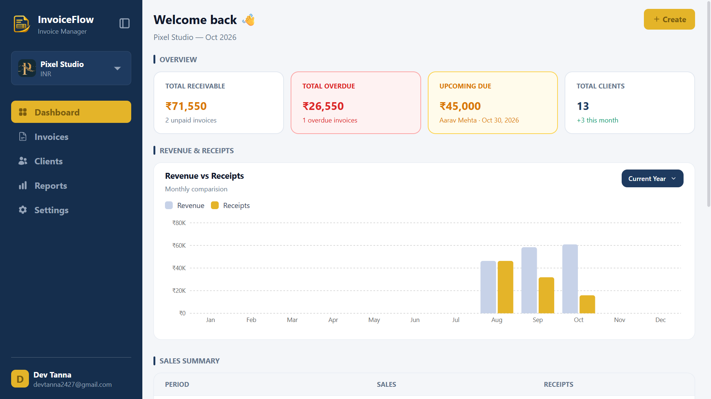
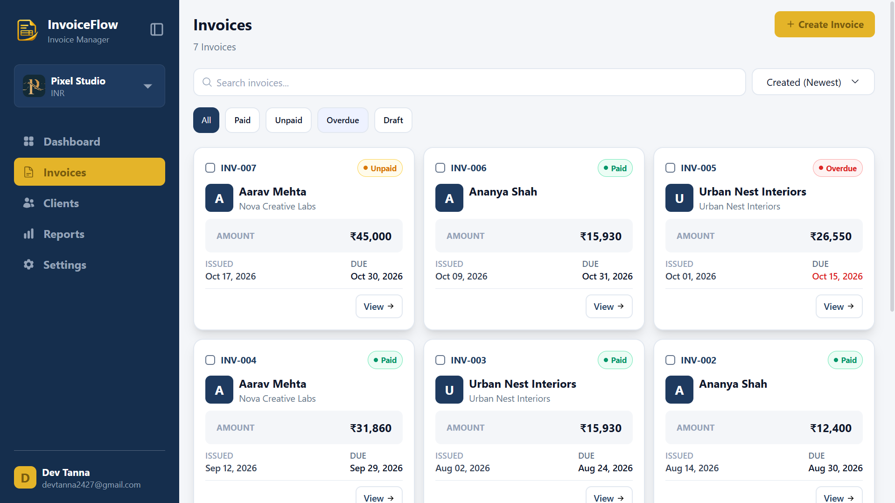
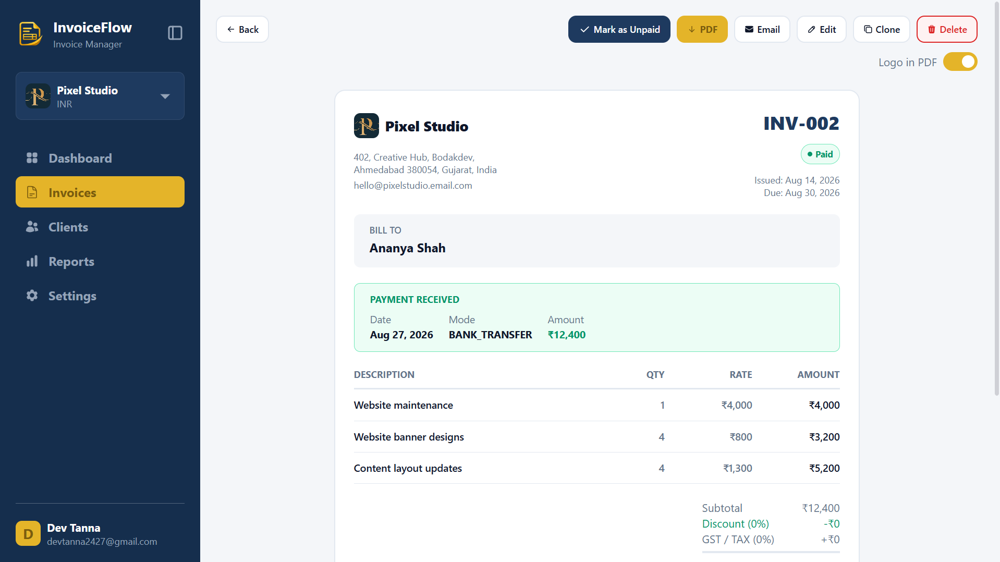
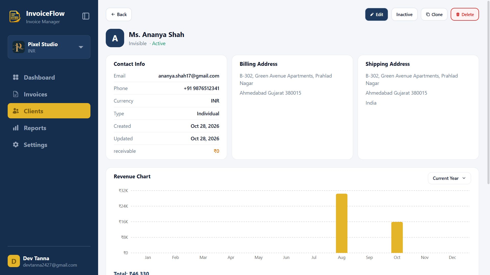

# InvoiceFlow

InvoiceFlow is a full-stack invoicing and business management app built with the MERN stack and TypeScript. It helps small businesses organize clients, create and track invoices, and review sales and payment activity.

[Live App](https://invoice-flow-three-sandy.vercel.app) · [GitHub Repository](https://github.com/Dev-2427/InvoiceFlow)

## Features

- **Authentication:** Google sign-in, credential sign-in, verification and password reset flows, and session management.
- **Organizations:** Create and manage business profiles, organization logos, billing details, and currency settings.
- **Client management:** Add and update individual or business clients, search and filter clients, and view client invoice and revenue details.
- **Invoice management:** Create and edit invoices with line items, tax, discounts, notes, payment information, and downloadable PDF output.
- **Invoice lifecycle:** Track draft, unpaid, paid, and overdue invoices; soft-delete and restore invoices; and permanently remove old deleted invoices.
- **Dashboard and reports:** Review sales, receipts, revenue charts, recent invoices, and filtered financial reports.
- **Background jobs:** Update overdue invoice statuses, clean up soft-deleted invoices, and remove stale unverified accounts.
- **Account and organization settings:** Manage profile details, passwords, active sessions, and organization settings.

## Screenshots







## Tech Stack

**Frontend**
- React 19, TypeScript, Vite
- React Router, Zustand, Axios
- Tailwind CSS, Recharts, React Hook Form, Zod

**Backend**
- Node.js, Express 5, TypeScript
- MongoDB and Mongoose
- JWT-based authentication, Google OAuth
- Nodemailer, ImageKit, node-cron

## Project Structure

```text
InvoiceFlow/
├── backend/       # Express API, MongoDB models, auth, and background jobs
└── frontend/      # React application
```

## Getting Started

### Prerequisites

- Node.js 20 or newer
- npm
- A MongoDB database (local or hosted)
- Google OAuth credentials
- ImageKit credentials if you want organization logo uploads
- Gmail SMTP credentials if you want email delivery in a supported environment

### 1. Clone the repository

```bash
git clone https://github.com/Dev-2427/InvoiceFlow.git
cd InvoiceFlow
```

### 2. Configure the backend

Create `backend/.env`:

```env
PORT=3000
NODE_ENV=development
CLIENT_URL=http://localhost:5173

MONGODB_URI=your_mongodb_connection_string

ACCESS_TOKEN_SECRET=replace_with_a_long_random_secret
REFRESH_TOKEN_SECRET=replace_with_a_long_random_secret
RESET_PASSWORD_SECRET=replace_with_a_long_random_secret

GOOGLE_CLIENT_ID=your_google_oauth_client_id
GOOGLE_CLIENT_SECRET=your_google_oauth_client_secret

IMAGEKIT_PUBLIC_KEY=your_imagekit_public_key
IMAGEKIT_PRIVATE_KEY=your_imagekit_private_key
IMAGEKIT_URL_ENDPOINT=your_imagekit_url_endpoint

EMAIL_USER=your_gmail_address
EMAIL_PASS=your_gmail_app_password
```

Use a Gmail App Password for `EMAIL_PASS`; do not put your regular Gmail password in the file. Keep real credentials private and never commit `.env` files.

### 3. Configure the frontend

Create `frontend/.env`:

```env
VITE_SERVER_URL=http://localhost:3000
VITE_GOOGLE_CLIENT_ID=your_google_oauth_client_id
```

Use the same Google OAuth client ID for the frontend and backend. Add your local and deployed app origins to the authorized origins in Google Cloud Console.

### 4. Install dependencies

Open two terminals from the repository root.

Backend:

```bash
cd backend
npm install
npm run dev
```

Frontend:

```bash
cd frontend
npm install
npm run dev
```

The Vite development server runs at [http://localhost:5173](http://localhost:5173), and the API runs on the port set by `PORT` (3000 by default).

### Production builds

Build the backend:

```bash
cd backend
npm run build
npm start
```

Build the frontend:

```bash
cd frontend
npm run build
npm run preview
```

## Deployment Notes

- Deploy the frontend and backend as separate services and set their environment variables in the hosting dashboards.
- Set backend `CLIENT_URL` to the deployed frontend origin and frontend `VITE_SERVER_URL` to the deployed backend URL.
- Configure the Google OAuth authorized JavaScript origins for both local development and the deployed frontend.
- The backend currently uses Gmail SMTP through Nodemailer. The production code intentionally returns a temporary unavailable response for credential sign-up and invoice email sending because SMTP delivery is unavailable on the current Render free-tier setup. Password-reset email also depends on SMTP and may fail in that environment. Configure a supported email provider and update the relevant production behavior before enabling these flows.
- The frontend uses credentialed requests, so configure CORS and the deployed client URL consistently.
